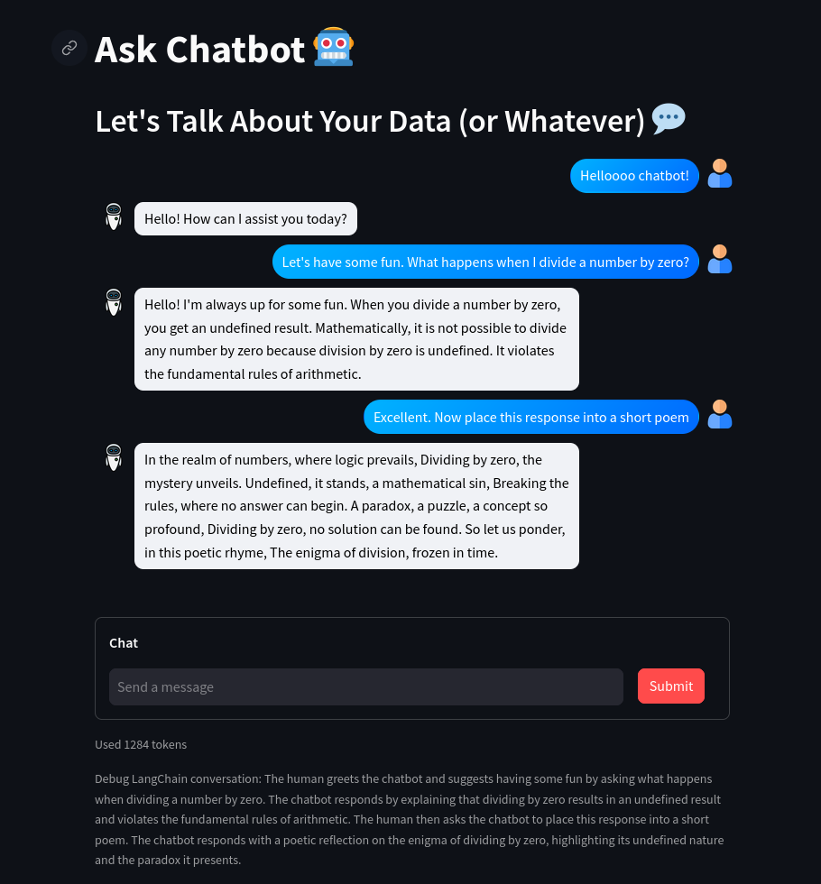

<div align="center">


# Ask Chatbot

Streamlit web app providing a Large Language Model (LLM) chatbot with a custom knowledge base


</div>

## [Live Demo](https://ask-chatbot.streamlit.app/)

- Deployed to Streamlit Community Cloud ☁️
- Conversation LLM chatbot chain only
- For ease of use and privacy, the semantic search of personal or organizational documents to create a custom knowledge base for the LLM will be available only as a local deployment feature

## Project Details

- Python 3.12
- Streamlit
- LangChain
- OpenAI (GPT-5)

## Getting Started

**Prerequisites:** Python 3.12 (or [conda](https://conda-forge.org/download/)) and an [OpenAI API key](https://platform.openai.com/api-keys).

1. Clone the repo

   ```
   git clone https://github.com/c-grigsby/ask-chatbot.git
   cd ask-chatbot
   ```

2. Create and activate an environment with Python 3.12 (choose one)

   - venv

     ```
     python3.12 -m venv venv
     source venv/bin/activate
     ```

   - conda

     ```
     conda create -n ask-chatbot -c conda-forge python=3.12
     conda activate ask-chatbot
     ```

3. Install dependencies

   ```
   pip install -r requirements.txt
   ```

4. Add your OpenAI API key

   ```
   cp -r .streamlit.example .streamlit
   ```

   Then set `OPENAI_API_KEY` in `.streamlit/secrets.toml`. This folder is gitignored, so your key is never committed.

5. Run the app

   ```
   streamlit run app.py
   ```

   Open your browser at http://localhost:8501

To leave the environment, run `deactivate` (venv) or `conda deactivate` (conda).

<div align="center">

|                    LLM Conversation                     |
| :-----------------------------------------------------: |
|  |

</div>